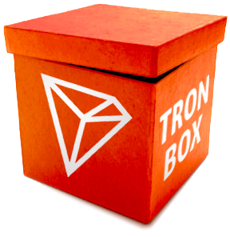

<p align="center">
  <a href="https://tronbox.io/" title="TronBox Website">
    
  </a>
</p>

# TronBox

TronBox is a development framework and testing environment for smart contracts on blockchains using the TRON Virtual Machine (TVM). Based on [Truffle](https://www.trufflesuite.com/truffle), it provides familiar workflows for building, testing, and deploying contracts on TRON.

With TronBox, you get:

- Smart contract compilation, linking, deployment, and artifact management.
- A local development node with funded accounts.
- An interactive console for working with contracts.
- Automated JavaScript contract tests.
- Scriptable migrations and network configuration.

## Quick Start

### Install

Install TronBox globally with npm:

```shell
npm install -g tronbox
```

For details, see [Install TronBox](https://tronbox.io/docs/guides/installation).

### Create a project

In an empty directory, initialize a project and select a built-in template:

```shell
tronbox init
```

Generated projects include:

| Path                | Purpose                                 |
| ------------------- | --------------------------------------- |
| `contracts/`        | Solidity contracts                      |
| `migrations/`       | Deployment scripts                      |
| `test/`             | JavaScript contract tests               |
| `tronbox-config.js` | TRON network and compiler configuration |

For a walkthrough using the MetaCoin template, see [Quickstart](https://tronbox.io/docs/quickstart).

### Compile

Compile the contracts in your project:

```shell
tronbox compile
```

Use `--all` to recompile every contract. Artifacts are written to `build/contracts/`. For details, see [Compile a Project](https://tronbox.io/docs/guides/compile-contracts).

### Start a local node

Start an in-memory TRON development network with funded accounts:

```shell
tronbox node
```

The node listens at `http://127.0.0.1:9090` by default. Keep it running and use another terminal for the following commands. Alternatively, you can use the [TronBox Runtime Environment (TRE)](https://hub.docker.com/r/tronbox/tre).

### Migrate

Deploy contracts using your project's migration scripts:

```shell
tronbox migrate
```

Use `--network <name>` to select a network defined in `tronbox-config.js`. For details, see [Contract Deployment (Migrations)](https://tronbox.io/docs/guides/deploy-contracts).

### Test

Run your project's contract tests:

```shell
tronbox test
```

To run a single test file, pass its path to `tronbox test`. For details, see [Test Your Contracts](https://tronbox.io/docs/guides/test-contracts).

### Console

Open an interactive console with your project's contracts available:

```shell
tronbox console
```

The prompt shows the selected network:

```text
tronbox(development)>
```

For details, see [Interact with a Contract](https://tronbox.io/docs/guides/interact-with-contracts).

## Integrity Check

Use the following GPG public key to verify package signatures:

```text
pub: 82C1 BB84 1BFA FD01 9CA6  1ACB E98F C329 87F3 BF76
uid: dev@tronbox.io
```

## Resources

For more guides and examples, see the [Official TronBox Documentation](https://tronbox.io/docs/).

To contribute, see [CONTRIBUTING.md](https://github.com/tronprotocol/tronbox/blob/master/CONTRIBUTING.md).
